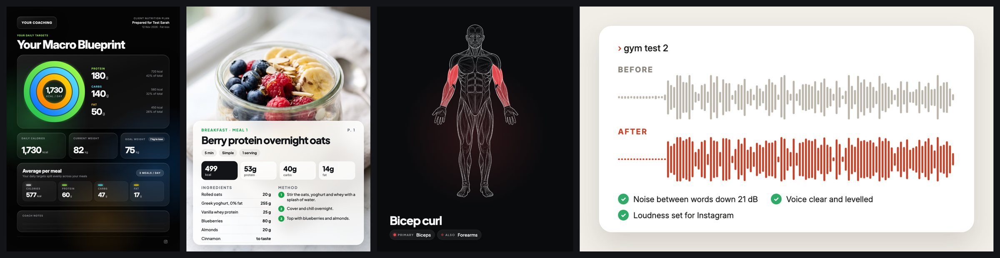

# /coach: Claude skills for fitness coaches

Five tools inside Claude Code. Type `/coach`, pick one, and get a finished file you can send to a client or post.

| Type | Give it | You get |
|---|---|---|
| `/coach audio` | A video or voice note filmed in the gym | The same clip with a clean, clear voice at Instagram loudness, plus a before/after picture |
| `/coach anatomy` | An exercise ("shoulder press") | A drawn body with the muscles it works glowing, on a transparent background for your edits. Male or female, white or black lines, eight glow colours |
| `/coach macros` | Your client's height, weight, age and goal | A branded macro card (image and PDF) with their calories, protein, carbs and fat |
| `/coach meals` | What they like and don't eat | A recipe book and a weekly grocery list that hit those macros |
| `/coach edit` | Your raw footage | The full edit. See below |

## Install it (2 minutes)

You need **Claude Code**: the Claude desktop app (claude.ai/download) on a paid plan, then the **Code** tab.

1. Open the Code tab and choose any folder.
2. Paste this and press Enter:

       Install the coach skills from github.com/corbinsylk/coach-skills

3. **Connect Gemini** when Claude asks. A page opens in your browser: create a free key at Google AI Studio, paste it and
   click Save. Gemini draws any muscle the pack doesn't have yet and the food photo for every recipe (about 4 cents an image,
   charged by Google). The key stays on your computer.
4. Type `/coach`. If it doesn't show up yet, start a new chat.

That's it. It works in every folder from now on.

The first time you make a macro card or recipe book, Claude asks a few quick questions: your business name, your Instagram
handle, your logo, your accent colour and your heading font (pick from nine, or upload your own). The designs are locked; your
brand goes on them.

## Using it

Just talk to it:

- `/coach macros Sarah, 29, female, 168cm, 82kg, fat loss, goal 75kg, trains 4 days`
- `/coach meals` → it asks what she likes, what she won't eat, and how simple the recipes should be
- `/coach anatomy bulgarian split squat, female body`
- `/coach audio` and drag in your clip

Plain English works too: "work out macros for my new client" or "clean up the audio on this" both trigger it.

Everything lands in **Documents → Coach Skills**, one folder per client, and the folder opens by itself.

## What you need

- Claude Code (above)
- Google Chrome, which draws the cards and books (most computers already have it)
- A Google AI Studio key for Gemini (free to create; images cost about 4 cents each on Google's side)
- A Mac, Windows or Linux computer

Your clips and your clients' details stay on your computer. Only a muscle drawing or a dish description goes to your own
Gemini account when a new image is needed.

## /coach edit

The full video edit (the cut, captions, motion graphics, sound and colour, from your raw footage) runs inside **Creator OS**.
It isn't in this free pack. To get access, **message [@corbinsylk](https://ig.me/m/corbinsylk) on Instagram** with the words
**CREATOR OS**.

## Good to know

- Macros use the Mifflin-St Jeor formula with your client's job and training days, then a goal adjustment. Treat them as a
  starting point and adjust from their check-ins.
- The meal planner works out every recipe's macros from a nutrition table, then scales the portions until each meal hits its
  share of the day. Pick one recipe per meal and the day adds up.
- The audio clean-up is a free noise-removal model. It handles gym noise, fans and crowd well. Music as loud as your voice
  will still come through.

## Credits

Built by Corbin Sylk ([@corbinsylk](https://www.instagram.com/corbinsylk/)). Noise removal: the RNNoise model from
[GregorR/rnnoise-models](https://github.com/GregorR/rnnoise-models) running in FFmpeg. Fonts: Plus Jakarta Sans, Inter, Montserrat, DM Sans, Poppins,
Playfair Display, Fraunces, Lora and DM Serif Display (SIL Open Font License, included). Body drawings and food photos were made for this pack with Gemini.

The code is under the MIT licence. Use everything it makes for your clients and your content, commercial use included.
